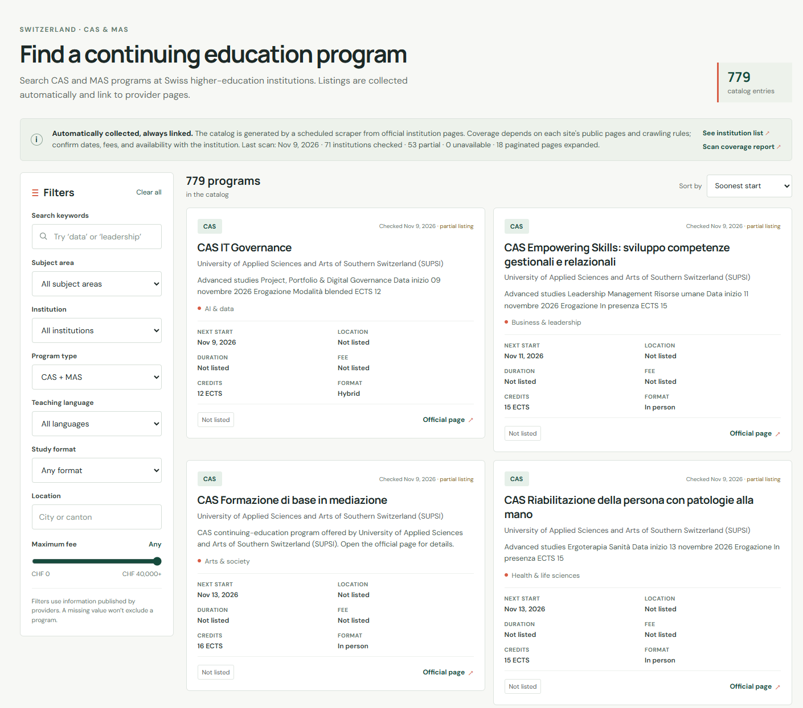

# FurtherStudy CH

Find and explore CAS and MAS continuing-education programs across Swiss higher-education institutions in one searchable catalog.

**[Open FurtherStudy CH →](https://raikilon.github.io/further-study/)**

## What you can do

- Search programs by keyword and narrow results by subject, institution, program type, teaching language, study format, location, and maximum fee.
- Compare available details such as start dates, duration, tuition fees, ECTS credits, and whether a course is online, in person, or hybrid.
- Follow each listing's **Official page** link to check requirements, confirm details, and apply directly with the institution.
- See when the catalog was last scanned and inspect the coverage report.

The catalog covers **CAS (Certificate of Advanced Studies)** and **MAS (Master of Advanced Studies)** programs. It helps you discover options across providers without searching every institution's website separately.

## Screenshot

[](https://raikilon.github.io/further-study/)

*Screenshot taken on November 9, 2026. Listings and counts change as the catalog is refreshed.*

## How it works

A Python scraper starts from the official swissuniversities list of accredited institutions, visits their public continuing-education pages, and collects program information and source links. An Angular frontend loads the generated catalog as static JSON, so searching the site does not require a backend server or an account.

GitHub Actions refreshes the catalog monthly and on manual runs, then builds and publishes the site to GitHub Pages. Pushes to `main` also build and deploy the site using the committed catalog.

Coverage depends on what each institution publishes and permits the scraper to access. Some listings have missing fields, and the catalog is not exhaustive. Last-known entries are kept when a provider is temporarily unavailable; always confirm dates, fees, and availability on the official program page.

## Run locally

```sh
npm ci
npm start
```

Open the local URL printed by Angular CLI (usually <http://localhost:4200>). The app reads `public/data/programs.json` as a static file.

## Run the scraper

Python 3.11+ is recommended.

```sh
python3 -m venv .venv
source .venv/bin/activate
pip install -r requirements.txt
python scripts/scrape_programs.py
python scripts/validate_catalog.py public/data/programs.json
npm test
```

The scraper uses the public accredited-institutions directory maintained by [swissuniversities](https://www.swissuniversities.ch/en/topics/studying/accredited-swiss-higher-education-institutions) as its starting point. It follows institution sites' robots rules, limits request rates, looks for sitemap/catalog pages, records official program URLs, and writes a coverage report to `public/data/scrape-report.json`. It does not need manually entered program records. Some sites use JavaScript-only catalogs or unusual layouts, so the report records fetch failures and the catalog links back to official pages for verification.

## Known site exceptions

The directory can contain old hostnames or hosts that are inaccessible from the scraper environment. These were checked with `curl` on 2026-11-09. Verified canonical destinations are configured in `scripts/catalog_scraper/settings.py` and allowed as same-institution aliases:

- `cesarritzcolleges.edu` uses `www.cesarritzcolleges.edu` (the bare host failed TLS; `www` returned HTTP 200).
- `ecav.ch` redirects to `edhea.ch`; `sfivet.swiss` redirects to `sfuvet.swiss`; and `unisi.ch` redirects to `usi.ch`.
- `eesp.ch` has an invalid certificate; its current institution site is `hetsl.ch`.
- `hepl.ch`, `phbern.ch`, and `phsg.ch` use verified HTTPS `www` homepages to avoid broken certificates or redirects to HTTP.
- `unizh.ch` is routed to the verified official UZH site at `uzh.ch`.

`he-arc.ch` timed out on both the bare and `www` HTTPS hosts, so it is temporarily excluded from discovery in `SKIP_ROOTS`. Retry it with `curl` before removing that exclusion. Excluding a provider from future scans does not delete any last-known catalog entries; the repository's merge keeps those entries unless they are explicitly removed.

The scraper merges newly discovered entries with the last known catalog rather than erasing programs when a provider is temporarily unavailable. It exits without replacing the catalog if it discovers no programs. Program facts can still change; confirm them with the institution before applying.

Optional local limits for a quick test:

```sh
python scripts/scrape_programs.py --max-providers 4 --max-pages-per-provider 12 \
  --output tmp/programs.json --report tmp/scrape-report.json
```

Refresh one provider without changing the last-known entries for other institutions:

```sh
python scripts/scrape_programs.py --provider-domain supsi.ch
```

## Code layout

- `src/app/app.component.ts` is just the Angular application shell.
- `src/app/catalog/` contains the page composition, filter facade, and pure filtering/sorting helpers.
- `src/app/catalog/components/` contains the hero, notice, filter form, results list, program card, and static explainer components. Components emit events or render inputs; they do not own catalog filtering.
- `src/app/pipes/` contains presentation-only label, date, and fee formatting.
- `scripts/catalog_scraper/` separates institution discovery (`SwissuniversitiesDirectory`), respectful HTTP (`PoliteFetcher`), sitemap reading (`SitemapReader`), program parsing (`ProgramParser`), per-provider crawling (`InstitutionCrawler`), and persistence/orchestration (`CatalogRepository`, `CatalogScraper`). Pagination is handled through a generic HTML-link adapter plus a SUPSI widget adapter. `scripts/scrape_programs.py` remains the small CLI entry point used locally and by Actions.

## GitHub Pages automation

The workflow in `.github/workflows/pages.yml` runs on pushes, monthly, and manually via **Actions → Update catalog and deploy**. On a scheduled or manual run it scrapes, validates, commits changed JSON/report files with the GitHub Actions bot, builds Angular with a relative base URL, then deploys that same build to Pages. This keeps the committed JSON and the live site in sync without relying on a second workflow trigger.

In repository **Settings → Pages**, choose **GitHub Actions** as the source. The workflow requires `contents: write`, `pages: write`, and `id-token: write` permissions.
